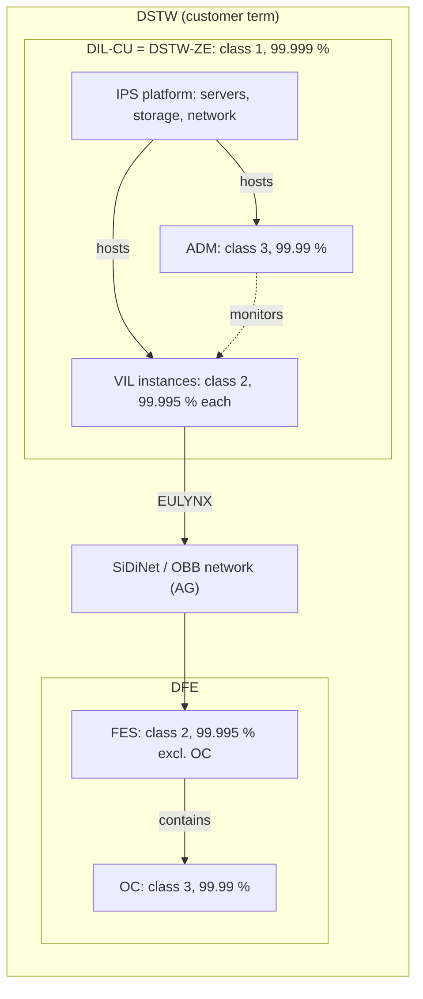
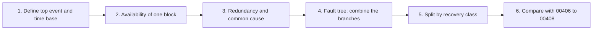
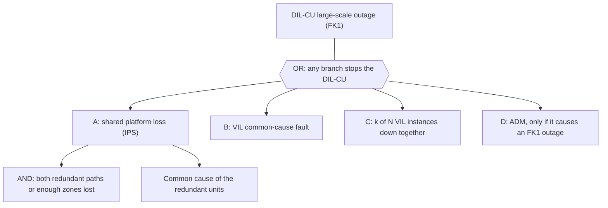

# Proposed RAM Review Responses — External Network and DIL-CU Availability

**Document reviewed:** [RAMP_DIL_VIL_3BU_17300_1209_DUAPA_Ed01.pdf](../RAMP_DIL_VIL_3BU_17300_1209_DUAPA_Ed01.pdf)  
**Status:** Draft response for project review; confirm the current approved requirements baseline, architecture, and responsibility matrix before baselining.

## Executive summary

The RAM Plan describes the VIL scope and says that IPS and DFE are addressed in separate RAM Plans. It does not yet define how externally provided ÖBB communications networks are treated in the RAM demonstration, or how individual solution-element results will be combined to demonstrate a system-level target.

The SSS DIL RAM requirements identify the DIL-CU as comprising VIL, ADM, and IPS; IPS also provides server hardware and network components. DFE is addressed separately for field elements. Consequently, the DIL-CU demonstration and a wider operational end-to-end demonstration should be distinguished. Include DFE in the latter only where the requirement’s defined service boundary requires it.

No external-network availability figure, component allocation, network topology, or common-cause data is established by the RAM Plan reviewed. These must be obtained or agreed; they should not be replaced by an assumed perfect network or by unsupported numerical allocations.

## 1. General comment — external ÖBB communication networks

> “The availability dependency on external ÖBB communication networks is not defined. Please document the assumptions and boundary conditions used for RAM demonstration.”

### Proposed response — external network

**Agreed.** The RAM Plan will be clarified to identify the interfaces between the VIL/IPS solution and ÖBB-provided communications networks, and to state how these external dependencies are treated in each availability demonstration. Equipment and services outside the agreed supplier/system boundary will not be silently treated as 100% available or as having no effect.

The solution-element analysis will report the availability of the in-scope solution under its stated operating conditions. Where an external network is required for the assessed service, its availability and failure/recovery behaviour will be included in the end-to-end service model using ÖBB-provided evidence or a formally agreed assumption. If adequate network data is unavailable, the result will be explicitly conditional on network availability and will not be presented as an unconditional end-to-end operational availability demonstration.

### Proposed RAM Plan text — external networks

> **External communications networks and RAM boundaries**
>
> For each RAM analysis, the system boundary shall identify the supplier-provided equipment and the interfaces to externally provided communications networks, including the relevant ÖBB network segments and services. The applicable network paths and the functions dependent on them shall be identified from the approved system architecture and interface documentation.
>
> External networks outside the agreed supplier boundary are not included in the supplier equipment failure-rate calculation. They shall nevertheless be treated as dependencies in the availability assessment wherever loss or degradation of the network can prevent the assessed service from being delivered. The analysis shall state whether its result is (a) conditional availability of the in-scope solution assuming the external service meets an agreed availability/interface condition, or (b) end-to-end service availability including the external network.
>
> An end-to-end calculation shall use network availability, outage and restoration data supplied by the network owner or another project-approved source. If these data are not available, the assumption and its source shall be agreed with the relevant parties; the result shall be marked conditional and the data gap recorded. No external-network availability value shall be assumed to be 100% without an agreed and justified basis.
>
> The model shall document the service boundary, required network paths, operating and maintenance conditions, availability observation period, treatment of planned outages and service-impacting degradation, restoration assumptions, and any redundancy or common-cause assumptions. Redundant paths shall only be credited where the architecture and failure independence/common-cause assumptions are supported by evidence. Network-related operational events shall be distinguishable in the availability records from failures attributable to the VIL, IPS, or DFE.

### Boundary conditions to confirm and record

| Item | Required clarification / evidence |
| --- | --- |
| Network boundary | Named network segments, equipment, services, demarcation points, and responsible owner/operator; confirm these against the approved architecture and interface documents. |
| Service impact | Define when loss, delay, or degradation of communications makes the assessed railway function unavailable. Use approved interface and operational criteria; do not invent thresholds. |
| Availability input | ÖBB/network-owner availability and outage/restoration data, or a documented and approved assumption with source and validity period. |
| Resilience | Route/path topology, protection and switchover behaviour, shared equipment, and credible common-cause dependencies. Do not presume independent or redundant paths without evidence. |
| Measurement rules | Required operating period, denominator, planned-maintenance treatment, failure start/stop rules, restoration/reintegration, and attribution of service-affecting versus non-service-affecting events. |
| Demonstration status | Separate a conditional in-scope result from an end-to-end result that includes external-network performance; identify any open data or agreement needed to close the latter. |

## 2. General comment — DIL-CU availability and VIL/IPS/DFE contributions

> “The RAM Plan excludes IPS Solution and DFE from scope, while availability requirements for the complete DIL-CU have to be demonstrated. Please clarify how end-to-end availability figures will be derived and apportioned across VIL, IPS and DFE contributions.”

### Proposed response to reviewer

**Agreed.** The RAM Plan will state that separate RAM analyses for VIL, IPS, and DFE do not remove the need to demonstrate any applicable system-level availability requirement. The responsible solution-element owners will provide traceable availability inputs and assumptions for the system-level aggregation.

The applicable SSS DIL RAM specification describes the DIL-CU as comprising VIL, ADM, and IPS, and states that IPS provides server hardware and network components. It treats DFE/field elements separately. Therefore, the project should distinguish:

1. **DIL-CU availability:** aggregate the contributions that fall within the approved DIL-CU requirement boundary. The DIL-CU requirements EL4-DIL-SSS-REQ-00406, -00407 and -00408 are allocated to DIL, VIL and IPS only; DFE is not allocated to them. ADM has its own class 3 requirement (EL4-DIL-SSS-REQ-01481).
2. **Wider operational end-to-end availability:** include DFE and other required external services only where the requirement’s defined end-to-end service boundary includes them. Do not label this wider result as DIL-CU availability unless the applicable requirement baseline defines it that way.

The allocation will be derived from the approved system architecture and requirement definitions, using compatible availability measures and evidenced solution-element data. Numerical allocations cannot be set from the RAM Plan alone and remain subject to the approved dependability analysis and responsibility/interface agreements.

### How the elements relate

Sources: SSS DIL RAMS Ed02PD01 (chapters Availability, FES, OC; glossary), customer PH D2.5 (2.1.0-1 to 2.1.0-4), customer PH D2.2 RAMS (5.3, 5.8), DIL Technische Konzepte Ed07 (F4 FES/OC, F16 ADM), SEMP IPS (WBS), RAMP DFE review.

| Term | What it is | Solution element / owner | Availability requirement (SSS DIL RAMS Ed02PD01) | Relation to the others |
| --- | --- | --- | --- | --- |
| **DSTW** (customer term) | Whole digital interlocking: data centre with all geo-redundant sites, all FES, EST, OC and the outdoor elements (PH D2.5, 2.1.0-1). | GA DIL integration | No single end-to-end figure. FRACAS proof is required per system: Rechenzentrum, VSTW, FES, OC (PH 5.8.0-2, 5.8.0-3). | Contains everything below. |
| **DIL-CU** (SSS) = **DSTW-ZE** (customer) | Central unit. SSS: comprises VIL, ADM and IPS; IPS provides the server hardware and network. Customer D2.5 2.1.0-3: DSTW-ZE = VSTW plus server hardware. | GA DIL, VIL, IPS (incl. ADM work package) | Class 1: overall >= 99.999 % (00406); distribution 99.9998 / 99.9996 / 99.9996 % (00407); outages without operational impact >= 99.7154 % (00408). Allocation: DIL, VIL, IPS. | Central part of the DSTW; connects to the field side through the network (SiDiNet). |
| **VIL** (= VSTW) | Virtual interlocking: ELEKTRA Core (CC, RCU, DGP) and ECMUX on the TAS Platform. A VIL instance controls one station or station zone. | VIL | Class 2 per VIL instance: >= 99.995 % (00587); distribution 99.9979 / 99.999 / 99.9996 % (00569); no-impact outages >= 99.7154 % (00570). | Runs on IPS; part of the DIL-CU; one DIL-CU hosts many instances. |
| **IPS** | Integrated Platform Services: virtualisation platform (servers, storage, network, control plane, cluster management). | IPS Solution | No own requirement (the "IPS Availability" chapter is deleted as empty). Counts through 00406 to 00408. | Platform shared by all VIL instances and ADM. |
| **ADM** | Administration, Diagnosis and Monitoring (alarm, log, geo, VSTW and infrastructure monitoring, workflows). Delivered as work package in the IPS SEMP. | IPS Solution (WP ADM) | Class 3: >= 99.99 % (01481). Allocation: DIL, ADM. | Subsystem of the DIL-CU, but not on the interlocking control path. |
| **DFE** | Digital Field Elements: field-side solution element (IFC ZG62, FES S DCA, FES M DCA, FES M AzLM, FES S IFC LCSI prototype in Phase 1). | DFE Solution | Via FES, OC and converter requirements below. Not allocated to 00406 to 00408. | Outside the DIL-CU; connected to VIL (ECMUX) via EULYNX over SiDiNet. |
| **FES** | Field Element Station: outdoor station (sizes S, M; L, XL) housing the OCs, switches and power interface; powered by the customer's energy stations (EST). | DFE | Class 2: >= 99.995 % excluding OC availability (00575); distribution 99.9979 % at MRT 0.5 h / 99.999 / 99.9996 % (00577); no-impact >= 99.7154 % (00578). Allocation: DIL, DFE. | Contains the OCs. |
| **OC** | Object Controller (OC-P point, OC-LS light signal, OC-TDS track detection, OC-IO generic I/O); EULYNX subsystems, located in the FES. | DFE (DCA, AzLM) | Class 3: >= 99.99 % (00581, 00582, 00583); block converters 01435; LCSI converters 01436 (later release). Allocation: DIL, DFE. | Connects the track elements to the VIL. |
| **External (AG)** | SiDiNet and ÖBB networks, DDSP, EST/power, data-centre site. | Customer | SiDiNet: requirements are specified by the customer and need not be observed by the supplier (SSS). | Dependencies; not in the supplier equipment calculation. |

### How to calculate the overall DIL-CU availability

**Key point.** The SSS does not ask for a product of VIL, IPS, FES and OC availabilities. It sets a separate target per element, and the customer requires proof per system (PH 5.8.0-2). The DIL-CU target (00406) is tied to defect class FK1, "outages with large-scale operational impact". A single VIL instance only controls one station or zone, so its 99.995 % target covers a different, smaller outage population. The DIL-CU number is therefore a top-level model result for ZE-wide outages, not the product of the element figures.

In short: the DIL-CU figure is built top-down from a fault tree of the events that stop the whole central unit. It is not built by multiplying the availabilities of the solution elements.

#### Overview of the method

#### Symbols and units

| Symbol | Meaning | Unit |
| --- | --- | --- |
| $A$ | Availability: share of time the required function is available | fraction (0.99999 = 99.999 %) |
| $U = 1 - A$ | Unavailability: share of time the function is lost | fraction |
| $\lambda$ | Failure rate of a block (constant) | 1/h; 1 FIT = $10^{-9}$ 1/h |
| $\mathrm{MTTF} = 1/\lambda$ | Mean time to failure | h |
| $\mathrm{MDT}$ | Mean down time: from loss of the function to its restoration | h |
| $\beta$ | Common-cause share: fraction of the failure rate that hits both redundant units together | fraction |
| $f$ | Frequency of an outage event | events per year |
| $d$ | Duration of one outage event | min |
| $T$ | Observation time | $365 \cdot 24 = 8760$ h or $525\,600$ min |

Conversion used throughout: $U \cdot 525\,600$ gives the unavailable minutes per year.

#### Step 1 - define the top event and the time base

The top event is an outage of the DIL-CU with large-scale operational impact (defect class FK1). The SSS does not say what "large-scale" means (for example how many VIL instances); this must be agreed with the customer because it decides which failures belong in the model. The time base is a continuous year, $T = 525\,600$ min, as an interpretation aid; the contractual observation period is not defined in the SSS.

#### Step 2 - availability of one block

The SSS defines availability as

$$A = \frac{\mathrm{MTTF}}{\mathrm{MTTF} + \mathrm{MDT}}$$

Read it as: the block works for $\mathrm{MTTF}$ on average, then is down for $\mathrm{MDT}$, then works again. $A$ is the working share of that cycle. With a constant failure rate $\mathrm{MTTF} = 1/\lambda$, so

$$A = \frac{1/\lambda}{1/\lambda + \mathrm{MDT}} = \frac{1}{1 + \lambda \cdot \mathrm{MDT}} \qquad\Rightarrow\qquad U = \frac{\lambda \cdot \mathrm{MDT}}{1 + \lambda \cdot \mathrm{MDT}} \approx \lambda \cdot \mathrm{MDT}$$

The approximation holds when $\lambda \cdot \mathrm{MDT} \ll 1$, which is always the case here. It is the main working formula: unavailability is roughly failure rate times down time.

$\mathrm{MDT}$ must cover the whole time the function is lost: detection, administrative and logistic delay, repair or restart, and reintegration (see Figure 5 of the RAM Plan). Using only the active repair time of 0.5 h (MRT) understates $U$.

Example with illustrative numbers (not project data): $\lambda = 10^{-5}$ 1/h (10 000 FIT) and $\mathrm{MDT} = 4$ h give $U \approx 10^{-5} \cdot 4 = 4 \cdot 10^{-5}$, so $A = 99.996\ \%$, or $4 \cdot 10^{-5} \cdot 525\,600 \approx 21$ min per year.

#### Step 3 - redundancy and common cause

Redundant parts are not single blocks. Two rules cover most cases.

For a 1oo2 pair (the function is lost only if both units are down) with independent repair, the pair is down only when both are down at the same time:

$$U_{1oo2} \approx U_1 \cdot U_2 \approx (\lambda \cdot \mathrm{MDT})^2$$

If one repair team can only repair one unit at a time, the second failure waits, and the result is about twice as large: $U_{1oo2} \approx 2\,(\lambda \cdot \mathrm{MDT})^2$.

Real redundant units are not fully independent (shared software, power, configuration, timing). A fraction $\beta$ of the failure rate is assumed to hit both at once. That part is not reduced by redundancy:

$$U_{\text{pair}} \approx \underbrace{\big((1-\beta)\,\lambda \cdot \mathrm{MDT}\big)^2}_{\text{independent failures}} \;+\; \underbrace{\beta \cdot \lambda \cdot \mathrm{MDT}}_{\text{common cause}}$$

Same illustrative numbers as above, with $\beta = 0.02$ (a placeholder; the project value needs a justification):

| Term | Calculation | Result |
| --- | --- | --- |
| Independent part | $(0.98 \cdot 4 \cdot 10^{-5})^2$ | $1.5 \cdot 10^{-9}$ |
| Common-cause part | $0.02 \cdot 4 \cdot 10^{-5}$ | $8.0 \cdot 10^{-7}$ |
| Pair total | sum | $\approx 8.0 \cdot 10^{-7}$ |

The common-cause part is about 500 times larger than the independent part. This is why the model must treat shared causes explicitly: adding redundancy does not help against them.

For k-out-of-N groups of identical, independent blocks with unavailability $q$ each, the probability that at least $k$ are down is approximately $\binom{N}{k} q^{k}$ for small $q$. For example $N = 60$ instances, $q = 5 \cdot 10^{-5}$ and $k = 10$ gives about $10^{-32}$: independent simultaneous failure of many instances is negligible. The real risk is a shared cause that hits many instances at once, which is why the next branches matter.

#### Step 4 - fault tree for the DIL-CU top event

| Branch | Content | Source of input |
| --- | --- | --- |
| A Shared platform loss | Failures of IPS elements that take down all or many VIL instances: loss of availability zones beyond what the balanced distribution tolerates, core network, control plane, storage, power distribution within supplier scope, geo-link if georedundant. | IPS Reliability Analysis |
| B VIL common cause | Faults that hit all instances at once: systematic SW fault in synchronised replicas, CDS/authorisation rejection, incompatible versions, split brain. | VIL analysis, safety concept |
| C Many instances down together | $k$ of $N$ instances unavailable at the same time, with $k$ = the agreed "large-scale" threshold. | VIL instance availability, $N$ from the configuration |
| D ADM | Only if ADM loss causes operational impact. Otherwise it is covered by its own class 3 requirement (01481) and is not in the series. | ADM analysis |

Gate rules (blocks assumed independent):

- AND gate (all inputs must fail): multiply, $U = \prod_i U_i$.
- OR gate (any input fails): $U = 1 - \prod_j (1 - U_j) \approx \sum_j U_j$. For values around $10^{-6}$ the error of the sum is about $10^{-12}$, so the sum is adequate.

$$U_{\text{DIL-CU}} = 1 - \prod_j (1 - U_j) \approx \sum_j U_j \qquad\qquad A_{\text{DIL-CU}} = 1 - U_{\text{DIL-CU}}$$

Every shared element appears once in this sum. The IPS platform is part of every VIL instance figure and also of the central model, so the VIL-instance figure must never be multiplied by an IPS figure to obtain the DIL-CU figure.

#### Step 5 - split by recovery class

Requirement 00407 splits the target by how an outage is restored. A branch is assigned to a class by its restoration mechanism. For an outage type that occurs $f$ times per year and lasts $d$ minutes each time:

$$U_j = \frac{f_j \cdot d_j}{525\,600\ \text{min}}$$

This is the second working formula. It turns an event frequency and a duration into unavailability, and it can be reversed to see what a budget allows:

$$f_{\max} = \frac{U_{\text{budget}} \cdot 525\,600}{d}$$

| Check | Target | Budget $U$ | Equivalent [min / 365 d] |
| --- | --- | --- | --- |
| Overall (00406) | $\ge 99.999\ \%$ | $1.0 \cdot 10^{-5}$ | 5.26 |
| Manual (00407) | $\ge 99.9998\ \%$ | $2.0 \cdot 10^{-6}$ | 1.05 |
| Automatic, 10 min (00407) | $\ge 99.9996\ \%$ | $4.0 \cdot 10^{-6}$ | 2.10 |
| Automatic, 2 min (00407) | $\ge 99.9996\ \%$ | $4.0 \cdot 10^{-6}$ | 2.10 |
| Sum of the three scenarios | | $1.0 \cdot 10^{-5}$ | 5.26 |
| No operational impact (00408) | $\ge 99.7154\ \%$ | $2.846 \cdot 10^{-3}$ | 1495.9 |

The three DIL-CU budgets add up exactly to the overall budget ($2 + 4 + 4 = 10$, in units of $10^{-6}$). For the VIL instance they add up to $3.5 \cdot 10^{-5}$, which is 70 % of its $5.0 \cdot 10^{-5}$ overall budget. The 00408 value is a different measure: exposure to errors without operational impact, for example time with lost redundancy. It is checked separately and is not part of the sum.

What the budgets mean in events, with $d$ taken as the restoration time of the class:

| Class | Budget [min / year] | Duration $d$ | Allowed frequency $f_{\max}$ | About one event per |
| --- | --- | --- | --- | --- |
| Manual, SSS 00407 value | 1.05 | 360 min (6 h) | 0.0029 / year | 343 years |
| Manual, value used in RAM Plan Table 9 | 1.05 | 62 min | 0.017 / year | 59 years |
| Automatic, 10 min | 2.10 | 10 min | 0.21 / year | 4.8 years |
| Automatic, 2 min | 2.10 | 2 min | 1.05 / year | 0.95 years |

The manual class depends strongly on the restoration time assumed. The SSS states 6 h while the RAM Plan Table 9 uses 62 min (open point 5 below); the budget supports 343 or 59 years between events depending on which input is correct.

#### Step 6 - worked example (illustrative numbers only)

This example shows the arithmetic with made-up inputs. It is not project data. In the real analysis the inputs come from the IPS and VIL Reliability Analyses.

| Branch | Class | Inputs (made up) | Calculation | $U$ | min / year | Class budget | Used |
| --- | --- | --- | --- | --- | --- | --- | --- |
| A Redundant platform pair | Manual | $\lambda = 10^{-5}$ 1/h, MDT 4 h, $\beta = 0.02$ | Step 3 pair formula | $8.0 \cdot 10^{-7}$ | 0.42 | $2.0 \cdot 10^{-6}$ | 40 % |
| B VIL common-cause fault, restarts automatically | Automatic 10 min | $f = 0.1$ / year, $d = 10$ min | $\dfrac{0.1 \cdot 10}{525\,600}$ | $1.9 \cdot 10^{-6}$ | 1.00 | $4.0 \cdot 10^{-6}$ | 48 % |
| C Platform event, automatic recovery | Automatic 2 min | $f = 0.5$ / year, $d = 2$ min | $\dfrac{0.5 \cdot 2}{525\,600}$ | $1.9 \cdot 10^{-6}$ | 1.00 | $4.0 \cdot 10^{-6}$ | 48 % |
| Total | | | sum | $4.6 \cdot 10^{-6}$ | 2.42 | $1.0 \cdot 10^{-5}$ | 46 % |

Result of the example: $A_{\text{DIL-CU}} = 1 - 4.6 \cdot 10^{-6} = 99.99954\ \%$, which meets 99.999 % with 54 % margin, and each class stays inside its budget. If a class or the total exceeded its budget, the branch with the largest $U$ is the one to improve (shorter restoration, less common cause, fewer events).

#### Step 7 - treat DFE separately

FES (00575 to 00578) and OC (00581 to 00583) are demonstrated against their own requirements in the DFE analysis. They are not inputs to the DIL-CU figure.

Optional informative view for one controlled element (not an SSS requirement). If the customer wants a chain figure for one signal, the requirement-level stack adds the budgets of the DIL-CU, the VIL instance, the FES and the OC:

$$U_{\text{chain}} \le 1.0 \cdot 10^{-5} + 5.0 \cdot 10^{-5} + 5.0 \cdot 10^{-5} + 1.0 \cdot 10^{-4} = 2.1 \cdot 10^{-4}$$

That is about 99.979 %, or 110 min per year. It is an upper bound of the requirements, not a prediction. It omits SiDiNet and the AG supplies, and it may double count the platform if the VIL-instance figure already includes platform outages. Do not present it as a contractual end-to-end target.

#### Common mistakes to avoid

| Mistake | Why it is wrong |
| --- | --- |
| Multiplying $A_{\text{VIL}} \cdot A_{\text{IPS}} \cdot A_{\text{ADM}}$ to get the DIL-CU figure | The platform is counted several times, ADM is not on the interlocking path, and the DIL-CU target is for large-scale outages, not for any single-instance outage. |
| Using the active repair time (MRT 0.5 h) as MDT | MDT includes detection, logistics and reintegration, so $U$ is understated. |
| Assuming redundant units fail independently | Common cause then disappears from the result, although it dominates (Step 3). |
| Mixing percent and fraction | 99.999 % is 0.99999. $U = 10^{-5}$ corresponds to 99.999 %, not 99.99 %. |
| Mixing the measures of 00406/00407 (outage time) and 00408 (exposure to errors without operational impact) | They measure different things and must not be added. |

### Open points found in the documents

| # | Finding | Action |
| --- | --- | --- |
| 1 | "Large-scale operational impact" (FK1) is not quantified in the SSS. | Agree a threshold with the customer, for example number or share of VIL instances, because it defines the DIL-CU top event. |
| 2 | ADM is part of the DIL-CU but has only class 3 (99.99 %), lower than class 1. In series it would cap the DIL-CU at 99.99 %. | Confirm that ADM loss is not an FK1 event and state this in the model boundary. |
| 3 | Boundary differs: SSS DIL-CU = VIL + ADM + IPS (including network); customer D2.5 DSTW-ZE = VSTW + server hardware, and D2.5 2.1.0-2 treats the network as part of the architecture but not of the safety installation. Customer PH 5.3.0-1 describes the Rechenzentrum unit including network, climate, UPS and DDSP as AG scope. | Fix the boundary and the network and power treatment in RAM Plan sections 3.2 and 5.6. |
| 4 | Customer response to PH 02_104: proof covers only components inside the agreed boundary; data-centre, power, SiDiNet, DDSP and other AG supplies are provided by the AG. 02_142 asks for proof for Rechenzentrum, VSTW, FES and OC within five years. | Align the RAM Plan with the agreed responses and record the AG data dependencies. |
| 5 | RAMP Table 9 shows 99.9999 % for the VIL 10-min scenario (TDT 5 min/y), while SSS 00569 states 99.999 %. RAMP Table 9 gives manual MTTR 62 min (DIL) and 225 min (VIL), while SSS 00407 and 00569 state 6 h. | Correct or explain in the next RAM Plan edition. |
| 6 | Verification fields of the SSS availability requirements are "to be added in a later edition". | Define the verification method in the RAM Plan and link it to the model. |
| 7 | RAMP Figure 6 lists EL4-DIL-SSS-REQ-00409 and -00410 (and VIL -00571, -00572). They exist as Draft in the general SSS DIL (3BU 17300 1251, Ed01 PD01; 00409 carries the open point "should the value be 0,99999?"). They are absent from the SSS DIL RAMS (3BU 17300 1257, Ed01 and Ed02PD01), where -00407 and -00569 carry the 10 min and 2 min scenarios with the same customer origins (PH 02_109, 02_110). | Confirm the controlling baseline. If the RAMS SSS controls, remove the four IDs from Figure 6 and trace the scenarios to -00407 and -00569. If they remain separate requirements, list them explicitly in the statement. |

### Suggested insertion points in the RAM Plan

| RAM Plan location | Suggested change |
| --- | --- |
| **Section 3.1, Project overview**, immediately after the paragraph stating that IPS and DFE are outside this RAM Plan | Clarify that separate IPS and DFE RAM Plans define their detailed analyses, but their interfaces and dependencies remain inputs to any applicable GA DIL/DIL-CU availability demonstration. State that separate plans do not, on their own, constitute an integrated system-level demonstration. |
| **Section 3.2, System overview**, alongside the architecture description and Figures 1 and 3 | Identify the DIL-CU assessment boundary and show its included elements and interfaces against the approved architecture. Distinguish DIL-CU elements (including VIL, IPS and ADM where confirmed by the baseline) from DFE/field elements and external services. |
| **Section 4.2, Availability requirements**, and **Section 6.2, RAM requirements**, after the applicable requirement list | Define which requirement is demonstrated at DIL-CU level and which is VIL-instance level. Add traceability to the applicable requirement baseline, service boundary, contributing element analyses, integrated model and verification evidence. Keep DFE/FES/OC requirements separately identified unless the applicable requirement explicitly defines a wider end-to-end boundary. |
| **Section 5.6, Reliability Analysis**, after the required analysis inputs | Specify the system-level availability model, accountable model owner, evidence required from VIL/IPS/ADM and (where applicable) DFE/network owners, treatment of shared resources and common-cause failures, restoration and outage accounting, and the approved allocation method. Require compatible definitions and prevent duplicate counting of shared infrastructure. |
| **Section 6.1, RAM deliverables**, and **Section 6.2** | Confirm that the required Reliability Analysis includes the integrated DIL-CU demonstration and records conditional or open results. If a wider operational-service model is required, identify it separately and state whether it is part of the Reliability Analysis or a controlled linked deliverable. |

The insertions should define the method, boundary, responsibilities and evidence trail; they should not introduce numerical element allocations until the applicable requirement baseline, architecture and dependability analysis support and approve them.

### Important target-consistency check

The SSS DIL RAMS (Ed02PD01) lists a DIL-CU class 1 overall target of at least 99.999 % (00406) and a VIL-instance class 2 target of at least 99.995 % (00587).

If both were the same measure over nested boundaries, a DIL-CU of 99.999 % could not be reached with a required VIL of only 99.995 %, because a series system cannot be more available than a required constituent. The SSS indicates that they are not the same measure: the comment of 00406 ties class 1 to defect class FK1, "outages with large-scale operational impact", whereas the VIL target applies per VIL instance, which controls one station or zone. This is the working interpretation; the SSS does not define "large-scale" and does not state the relationship explicitly, so it must be confirmed with the customer and documented in the RAM Plan. It is not a basis for changing the VIL target.

For illustration only, assuming continuous required service for 365 days:

- 99.999% availability corresponds to approximately 5.26 minutes of unavailability per year.
- 99.995% availability corresponds to approximately 26.28 minutes of unavailability per year.

### Short RAM Plan statement (proposed for Section 5.6, with a reference in Section 6.2)

> **Availability of the DIL-CU**
>
> The DIL-CU comprises VIL, ADM and IPS. The requirements EL4-DIL-SSS-REQ-00406, -00407 and -00408 are demonstrated at DIL-CU level by a system-level availability model (fault tree or reliability block diagram) maintained by the GA DIL RAM activity. The automatic-correction scenarios of 10 and 2 minutes (formerly EL4-DIL-SSS-REQ-00409 and -00410) are covered by the distribution in EL4-DIL-SSS-REQ-00407. The top event is an outage of the DIL-CU with large-scale operational impact (defect class FK1); the threshold for "large-scale" is to be agreed with the customer. Inputs are the failure rates, restoration times and redundancy logic from the VIL and IPS Reliability Analyses, and from the ADM analysis where an ADM failure can cause such an outage. Redundant groups are modelled according to the architecture, including common cause failures, and shared elements are counted once. Results are reported per recovery class (manual, automatic within 10 minutes, automatic within 2 minutes) and compared with the distribution in EL4-DIL-SSS-REQ-00407.
>
> The VIL-instance requirements (EL4-DIL-SSS-REQ-00587, -00569, -00570) are demonstrated per instance in the VIL Reliability Analysis and are not multiplied with the DIL-CU result. DFE (FES and OC) is not part of the DIL-CU and is demonstrated against its own requirements in the DFE Reliability Analysis. External networks and customer-supplied services are treated as described in the section on external dependencies.

### Proposed text for the RAM Plan

> **System-level availability demonstration and allocation**
>
> The RAM analyses for VIL, IPS, and DFE shall be prepared within their respective approved technical and responsibility boundaries. Their separation into individual RAM Plans does not, by itself, demonstrate a system-level availability requirement. The responsible system RAM activity shall maintain traceability from each applicable system-level requirement to its defined service boundary, contributing solution elements, analysis/model, input data, assumptions, and verification evidence.
>
> For the DIL-CU requirement, the model boundary and included elements shall follow the applicable approved requirement baseline and system architecture. The available SSS DIL RAMS baseline describes the DIL-CU as comprising VIL, ADM and IPS, while FES/OC availability requirements are addressed separately. DFE shall therefore be included in a wider end-to-end operational-service model only where that model’s approved requirement boundary includes the field elements and their interfaces. The DIL-CU and wider operational-service results shall be reported separately where their boundaries differ.
>
> For a service requiring all modelled elements in series, and only where their availability measures are compatible and failures are treated as independent, the model may calculate:
>
> `A_system = product(A_i)` and `U_system = 1 - A_system`
>
> where `A_i` is the availability of each required element and `U_system` is system unavailability. The model shall use the actual functional architecture: redundant paths and elements shall be represented using the relevant reliability block diagram/fault-tree logic, and common-cause failures, shared resources, switching/recovery behaviour, and dependencies shall be addressed. Independence shall not be assumed without justification.
>
> System-level availability targets shall be apportioned to contributing elements through an approved unavailability budget or other justified allocation method. The allocation shall be consistent with the requirement’s outage classes, system boundary, operating profile, restoration assumptions, and verification rules. A system-level result shall not be claimed by simply repeating the top-level target for each element or by combining figures based on incompatible definitions.
>
> The RAM Plan shall identify the owner of the system-level model and the input/evidence obligations of the VIL, IPS, ADM, DFE, and external-service owners as applicable. Missing data, unresolved boundaries, or unapproved allocations shall be recorded as open points and shall limit the claim made by the availability demonstration.

### Proposed allocation and evidence register

| Contribution | Treatment in demonstration | Required input/evidence | Boundary/status to confirm |
| --- | --- | --- | --- |
| VIL | Include in the DIL-CU model; use the VIL service boundary and its required interfaces. | VIL availability analysis, architecture/configuration, outage-class and restoration data, operational profile, dependencies, and assumptions. | Reconcile the VIL-instance target and outage definitions with the DIL-CU target. |
| IPS | Include in the DIL-CU model to the extent defined by the DIL-CU requirement and architecture; account for IPS platform, server, and network contributions once. | IPS RAM analysis, architecture, failure/repair and recovery data, redundancy/common-cause analysis, and interface assumptions. | Obtain from IPS owner; do not duplicate shared infrastructure in multiple model blocks. |
| ADM | Part of the DIL-CU composition, but has its own class 3 requirement (EL4-DIL-SSS-REQ-01481, 99.99 %). Include in the DIL-CU top-event model only if ADM loss causes an FK1 outage. | ADM availability evidence and its dependencies/interfaces. | Confirm that ADM is not on the interlocking control path; confirm scope and owner (work package in the IPS SEMP). |
| DFE / field elements | Include in the wider operational end-to-end model when required by that service boundary; keep separate from DIL-CU-only results if outside its approved definition. | DFE RAM analysis, relevant field-element service availability, outage/restoration data, and VIL/IPS interface assumptions. | Confirm the requirement’s end-to-end boundary and the applicable FES/OC definitions. |
| ÖBB external networks/services | Treat as an external dependency where service operation relies on them; include in end-to-end calculations or report the result as conditional. | Network-owner data or approved assumption; topology, outages, restoration, and interface performance criteria. | Confirm network demarcation, data source, and customer/supplier responsibility. |
| Integration/system model | Integrate the above contributions once using the approved service architecture and availability definitions. | Traceable model, requirement mapping, allocation rationale, sensitivity/uncertainty, and verification plan. | Name the accountable system RAM owner and obtain stakeholder approval. |

## Assumptions and open points

- This response is based on the supplied RAM Plan, the repository copy of the SSS DIL RAM specification, and project availability analyses. It is a proposed clarification, not an approved RAM allocation or compliance demonstration.
- The RAM Plan says IPS and DFE are outside its scope and will be addressed in separate RAM Plans. It does not establish current supplier/customer responsibilities for external networks.
- The supplied RAM Plan references an Ed01 SSS DIL RAM specification, and the repository also contains an Ed02PD01 SSS DIL RAMS document used by other project analyses. Configuration management must confirm the controlling approved edition before requirement boundaries, figures or statuses are baselined.
- The network topology, ÖBB network availability data, precise operational availability rules, approved element allocations, and named system-level model owner were not established by the supplied RAM Plan.
- The mathematical relationship between the DIL-CU and VIL targets is a consistency check. It requires confirmation that the targets share the same service and outage definitions before drawing a compliance conclusion.

## Recommended actions

1. Confirm the controlling SSS DIL RAM requirement baseline and the required service boundaries for DIL-CU, VIL, FES/OC, and the wider operational function.
2. Agree network demarcation, network-owner data, interface performance criteria, outage accounting, and responsibility for external-network dependencies with ÖBB.
3. Identify the system-level availability model owner and obtain consistent VIL, IPS, ADM, DFE, and external-service evidence from the respective owners.
4. Resolve the DIL-CU/VIL target relationship and approve an allocation/unavailability budget before claiming end-to-end compliance.
5. Update the RAM Plan and linked RAM analyses with the approved boundaries, assumptions, model references, open points, and verification approach.

## Applied Skills

- `Railway-RAM` — project-specific system boundaries, RAM evidence, assumptions, and risk framing.
- `RAM-Metrics` — availability definitions, data sources, and system/element KPI interpretation.
- `REQ-Review` — requirement-boundary consistency, testability, and traceable clarification wording.

## Repository information used

- [Railway RAM skill](../../../../Skills/Railway-RAM.md)
- [RAM Metrics skill](../../../../Skills/RAM-Metrics.md)
- [Requirements Review skill](../../../../Skills/REQ-Review.md)
- [RAM Plan under review](../RAMP_DIL_VIL_3BU_17300_1209_DUAPA_Ed01.pdf)
- [SSS DIL RAM specification, Ed01](../SSS_DIL_RAMS_3BU_17300_1257_DTAPA_Ed01.pdf)
- [SSS DIL RAMS, Ed02PD01](../SSS_DIL_RAMS_3BU_17300_1257_DTAPA_Ed02PD01.docx)
- [Prior DIL RAM Plan review](./RAM_DIL_3BU_17300_1209_DUAPC%20-%20Review.md)
- [VIL availability requirements analysis](./VIL_Availability_Requirements_Allocation.md)
- [VIL availability explanation](./VIL_Availability_Explanation.md)
